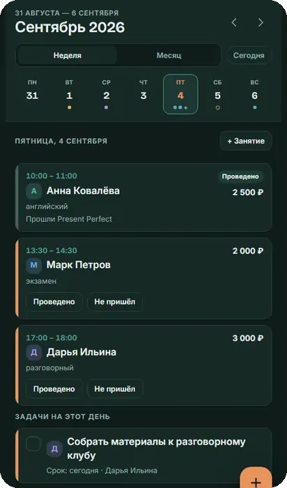
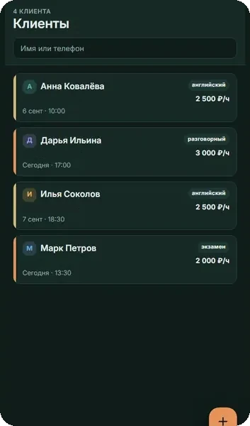
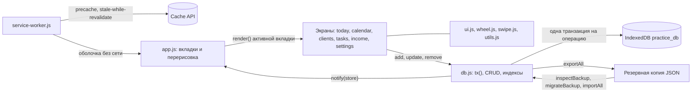

# Моя практика

Офлайн-PWA для репетиторов и тренеров: клиенты, календарь занятий с повторами, задачи и учёт дохода, данные хранятся только на устройстве.

*Offline-first PWA for solo tutors and coaches: clients, recurring sessions, tasks and income tracking, built with vanilla JS ES modules, IndexedDB and a service worker, with no build step.*


**Статус:** работающее приложение, в репозитории версия 1.1. Демо этой версии: https://borisbf1.github.io/moya-praktika-pwa/. На сайте автора опубликована более новая версия 1.5 с тратами, выгрузкой в CSV и напоминаниями: https://kostyukhinboris.ru/Calendar/. Её исходников здесь нет.

<p>
  
  
</p>

<sub>Тёмная тема на демо-данных: имена вымышленные, телефоны скрыты.</sub>

## Ключевые цифры

- **3 129 строк JavaScript** в 14 файлах (13 ES-модулей и service worker), плюс 1 190 строк CSS и 626 строк HTML.
- **Ноль зависимостей и шагов сборки:** нет npm, бандлера и фреймворка, браузер загружает модули напрямую.
- **IndexedDB:** 3 хранилища (`clients`, `events`, `tasks`) и 8 индексов.
- **Офлайн:** service worker при установке кэширует 19 файлов оболочки приложения.
- **5 вкладок** и экран настроек, 4 статуса занятия, 8 цветов меток клиентов.
- **Формат резервной копии версии 2** с пошаговой миграцией копий версии 1.

## Архитектура



- `db.js` — единственный модуль, который обращается к IndexedDB. Экраны получают и меняют данные только через его функции.
- Любая запись вызывает `notify()`. `app.js` подписан на изменения и перерисовывает активную вкладку и открытую карточку клиента, поэтому экраны не обновляют друг друга вручную.
- `ui.js`, `wheel.js` и `swipe.js` — компоненты без бизнес-логики: экраны поверх вкладок, шторки, колесо выбора, свайп.
- Service worker отвечает только за файлы приложения. Данные пользователя лежат в IndexedDB и в кэш не попадают.

## Что здесь нетривиального

- **Транзакционный слой над IndexedDB.** `tx(stores, mode, fn)` открывает одну транзакцию над несколькими хранилищами и возвращает промис, который выполняется только по `oncomplete` и отклоняется по `error` и `abort`. Создание серии, отмена её «хвоста» и восстановление из копии (очистка и заливка трёх хранилищ) проходят одной транзакцией, то есть атомарно. Занятия за период выбираются через `IDBKeyRange.bound` по индексу `date`.
- **Реактивность без фреймворка.** Observer `subscribe`/`notify` плюс схлопывание нескольких записей в одну перерисовку через `setTimeout(0)`. `requestAnimationFrame` здесь не подходит: в свёрнутом окне кадры не рисуются. Если приложение провисело открытым до следующего дня, по `visibilitychange` и `focus` экраны переходят на новую дату.
- **Offline-first service worker.** При `install` кэширует оболочку, статику отдаёт по схеме stale-while-revalidate, навигацию — network-first с запасным `index.html` из кэша. При `activate` удаляет кэши прежних версий (`CACHE_NAME`). Все пути относительные, поэтому приложение работает и из подпапки (`/Calendar/`, GitHub Pages).
- **Версионированный формат резервной копии.** JSON с `SCHEMA_VERSION`. `migrateBackup()` проводит старую копию по шагам (1 → 2 добавляет клиентам `color`), копия из более новой версии принимается с предупреждением, `inspectBackup()` до замены данных показывает, что лежит в файле. `id` сохраняются, поэтому связи по `clientId` не рвутся.
- **Повторы как материализованная серия, а не правило повторения.** Повторяющееся занятие — это N обычных записей с общим `seriesId` (по нему есть индекс). Каждое занятие можно перенести отдельно, а «хвост» серии отменить или удалить одним действием. Лимиты: до 60 занятий по счётчику и до 100 по дате окончания, шаг 7 или 14 дней.
- **Мобильный UX на чистых Web API.** Экраны поверх вкладок пишут состояние в History API, поэтому системная кнопка «назад» закрывает верхний экран, а не приложение. Колесо выбора построено на CSS scroll-snap с `role="listbox"`/`option`, `aria-selected` и управлением стрелками. Свайп на Pointer Events засчитывается, только если горизонталь в 1,4 раза длиннее вертикали, а клик сразу после свайпа гасится на фазе перехвата.

## Приватность и безопасность

- Данные клиентов не покидают устройство: в коде нет запросов к серверам. Сеть нужна только для шрифтов Google Fonts и фонового обновления файлов самого приложения.
- Пользовательские строки (имена, теги, заметки) проходят через `escapeHtml()` перед вставкой в разметку.
- Выгрузки резервных копий (`moya-praktika-*.json`) исключены через `.gitignore`.

## Тестирование

Автотестов нет, функциональность проверяется вручную в браузере. `node --check` проходит для всех 14 JS-файлов, `manifest.json` разбирается как валидный JSON.

## Запуск

Сборки нет, но нужен локальный веб-сервер, потому что ES-модули не загружаются по `file://`:

```bash
python -m http.server 5180
# открыть http://localhost:5180
```

Для установки на телефон и офлайн-режима нужен HTTPS или `localhost`. Для выкладки папку копируют на любой статический хостинг как есть. Порядок выпуска версий (`CACHE_NAME`, `SCHEMA_VERSION`, `whatsnew.js`) и ограничения описаны в [docs/DETAILS.md](docs/DETAILS.md).

## Как сделано

Код написан ИИ-агентом в Claude Code под руководством Бориса. Борис поставил задачу и составил подробное ТЗ: аудитория, технические принципы (чистый JS без npm и сборки, ES-модули, PWA с IndexedDB), цветовые токены тем, модель данных со статусами занятий и решение хранить повторы как серию с общим `seriesId`. После первой версии он вёл продуктовые итерации: колёса ввода, вид на месяц, цветные метки, цена по часовой ставке, обратная совместимость резервных копий (отсюда миграции схемы). Он же принимал результат, выпускал версии и опубликовал приложение на своём сайте.

Полное описание функций, модели данных и структуры файлов: [docs/DETAILS.md](docs/DETAILS.md).

---

Борис Костюхин · [kostyukhinboris.ru](https://kostyukhinboris.ru) · Telegram [@boris_BF](https://t.me/boris_BF)
